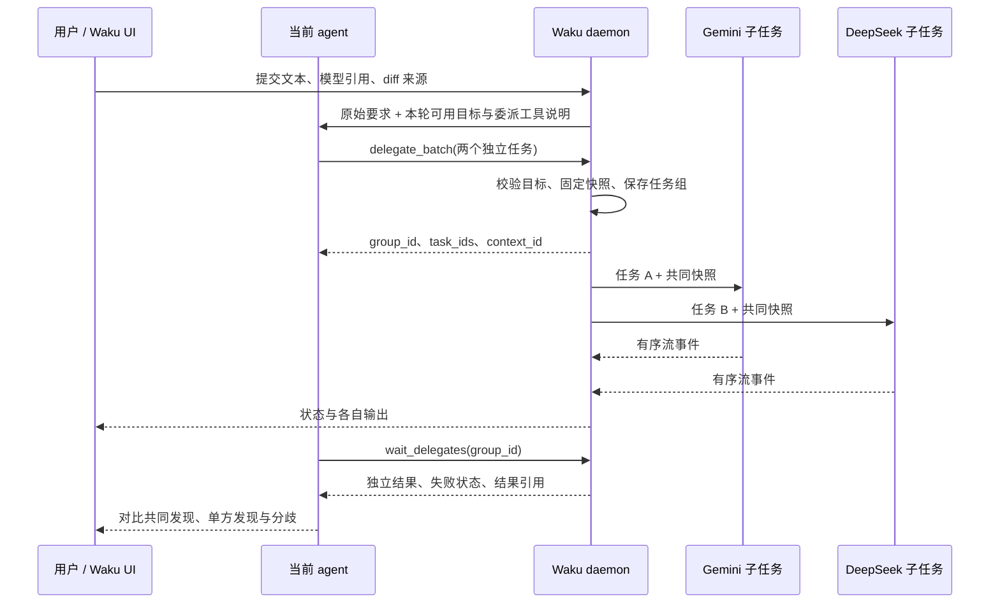

# Waku 跨模型子任务计划

状态：提案，待评审；本文没有实现相关功能。
日期：2026-10-31。

## 1. 目标与第一版范围

让用户在当前对话中输入：

> 分别用 ^Gemini 3.8 flash high 和 ^DeepSeek V4.1 Flash 1017 high 评审这个 diff，各自给结论，最后对比分歧。

当前 agent 理解要求、拆分任务，调用 Waku 提供的委派工具；Waku daemon 用指定的 provider、模型和思考强度运行子任务；当前 agent 获取各自的真实结果，完成对比。用户能查看每个子任务的任务说明、实时输出、工具活动和完整结论。

第一版交付以下完整流程：

- 一级、独立的代码评审子任务；各子任务读取相同的不可变代码上下文。
- 一个父轮次内一组委派，最多四个子任务；每组同时运行两个，daemon 全局同时运行四个。上限作为初始默认值，后续按实测调整。
- 子任务实时输出、单独停止、失败可见，以及两份结论之后的父 agent 汇总。
- 关闭详情、切换对话或客户端断线后继续运行；重新连接能恢复记录。
- 子任务不获得再次委派的能力。任意递归、多阶段协作、子任务修改代码、共享可写工作区留待后续版本。

例子中的模型名是用户意图，实际可用性以 daemon 发现的模型目录为准。第一版须验证这两个目标在用户配置的调用渠道上可用，不能把模型名称当作 provider 名称，也不能静默换模型或降低思考强度。

## 2. 已核实的代码基础

| 位置 | 当前能力与本次影响 |
| --- | --- |
| `crates/waku-client/src/composer_complete.rs`、`crates/waku-core/src/composer_complete.rs` | 两处都有 `/`、`@` 触发解析，尚无 `^`；应提取共享的纯解析逻辑，避免新增第三份规则。 |
| `src/app/autocomplete.rs`、`src/input.rs` | 补全使用缓存与现有键盘交互；输入框需要承载模型引用的文本区间和编辑行为。 |
| `src/app.rs`、`src/app/composer.rs`、`src/app/drafts.rs` | `ComposerSubmission` 目前只有文本和文件附件；模型引用必须贯穿提交、草稿、排队与重发。 |
| `crates/waku-protocol/src/model.rs` | 模型目录已包含模型 ID、子渠道和 reasoning 选项；现有 `BackgroundWork` 表示 provider 原生后台工作，不能直接当作 Waku 委派的持久记录。 |
| `crates/waku-core/src/driver/mod.rs` | `start_local` 可按 provider 启动 driver；参数已包含模型、reasoning effort、service tier、context window。 |
| `crates/waku-core/src/daemon.rs`、`server.rs` | daemon 拥有 provider runtime；已有按 session 串行的 mailbox、runtime ID、事件序号和有限回放。 |
| `src/app/streaming.rs`、`crates/waku-core/src/daemon.rs` | 当前正常会话的流事件主要由客户端投影，再通过 `SaveTaskState` 保存；仅复用事件转发不能保证无人打开的子任务有完整记录。 |
| `crates/waku-protocol/src/workspace.rs`、`crates/waku-core/src/workspace.rs`、`checkpoint.rs` | 已有 diff 来源、Git tree/checkpoint 与工作区快照能力，可用于固定评审对象；当前显示 diff 的字节上限不能直接当作完整评审输入。 |
| `db/schema.ts`、`db/migrations`、`crates/waku-core/src/persistence.rs` | SQLite 由 daemon 读写，迁移从 Drizzle schema 生成。 |

此外，`RuntimeMode` 是访问审批策略。不同 provider 对它的解释不同，不能据此宣称所有评审子任务都已受到只读约束。

## 3. 职责与执行流程



职责分配：

- **当前 agent**：理解自然语言，编写每个子任务的说明，等待结果，核对证据并汇总。
- **daemon**：解析调用目标、执行权限、固定上下文、启动与停止、并发限制、持久化、结果交付。
- **UI**：模型选择、任务状态、可查看的原始输出和控制；不运行 provider，也不承担子任务结果的唯一保存职责。

`^` 表示本轮可被调用的模型引用。实际委派由 agent 的工具调用触发；仅提到两个模型不会自动启动两次调用。例如“比较这两个模型的适用场景”可以只产生普通回答。

## 4. 模型引用与提交协议

### 4.1 引用的数据

新增共享、可序列化的模型引用，概念字段如下；最终命名在实现时遵循现有类型习惯：

```text
ModelReference
  reference_id
  provider
  model_id
  reasoning_effort
  service_tier? / context_window? / agent_preset?
  display_label

ModelMention
  reference_id
  text_range             // UTF-8 字节范围，须校验字符边界
```

`display_label` 用于展示；真实调用只使用经过 daemon 校验的 ID 与选项。补全候选明确展示调用渠道，避免同名模型歧义。reasoning effort 是独立选项，`high` 不拼接进模型 ID。

候选复用后台更新的模型目录，render 只读缓存。daemon 在执行前再次校验 provider 是否启用、二进制是否存在、模型与选项是否支持。目录变化不会重新解释已选引用。

### 4.2 输入行为

- 在正文的合法边界输入 `^` 打开模型候选；选定模型与思考强度后，形成带元数据的引用。
- 第一版使用现有文本输入框与带样式的区间表示引用，无须先实现新的富文本编辑器。
- 插入、删除、IME、撤销与重做均同时更新引用区间；编辑引用内部使该引用失效并要求重新选择，不能继续使用旧 ID。
- 复制为普通文本时保留可读名称。外部粘贴或手输完整名称需要经过目录解析与消歧，发送前显示已绑定的目标；未解析项保留草稿并提供重新选择入口。
- 目录解析仅在明确的模型引用编辑上下文发生。数学表达式 `x^2`、代码块里的 `^` 和普通引用文本不触发委派。
- 同一配置的重复引用可以共用一个目标 ID；任务本身按 `task_key` 区分，允许同模型承担不同任务。

### 4.3 元数据的传递

扩展 `ComposerDraft`、`ComposerSubmission`、`QueuedMessage`、用户 `Message` 的持久表示，保存引用及 diff 来源。附件仍走现有文件附件通道。

扩展 `Command::Prompt`，携带带默认值的可选 `delegation_context`，含稳定的父 `turn_id`、模型引用和 `review_source`。客户端 RPC adapter 负责传递；daemon 保存本轮清单，再向 provider 发送任务文本和简短工具说明。内部 provider driver 可以继续接收字符串 prompt。

共享协议增加类型化的委派查询、控制与事件，提升 `PROTOCOL_VERSION` 并同时更新 daemon/client。旧存储字段提供默认值；旧协议连接按现有握手拒绝，不能让旧端悄悄忽略模型引用。

第一版遇到正在进行的委派时，新消息进入现有 follow-up queue；不在该轮中增加或更换委派目标。队列消费时传递完整元数据，不能只剩文本。普通会话的 steering 保持现有行为；被委派清单覆盖的轮次走明确的排队分支。

## 5. 当前 agent 如何调用 Waku

### 5.1 接入方式与首批 provider

增加独立的 Waku agent-tools MCP bridge。建议由已有 `waku-daemon` 二进制的专用子命令提供 stdio 服务，转发到 daemon 内部的委派服务；它不启动第二个 daemon，也不依赖 Computer Use 的 debug 开关。

父 agent 接入与子任务运行是两种独立能力，分别探测：

| 角色 | 第一版计划 |
| --- | --- |
| 父 agent | 优先接入 Codex、OpenCode；两者现有 driver 有运行时注入 Waku MCP 的代码先例，正式支持仍须通过协议与真实调用验证。 |
| 子任务 | 复用现有 driver；逐个验证准确选模、思考强度、流事件、结束、取消及评审执行约束。 |
| 其他父 provider | 增加各自的 MCP 或原生工具 adapter，通过相同测试后开放；不假定所有 CLI 都能注入工具。 |

父 provider 未通过能力验证时，`^` 候选说明当前会话不支持委派，并保留输入。不能把引用直接发成普通文本后显示为已执行。

运行时只注册一次 bridge，本轮目标清单随 prompt 更新。bridge 使用绑定父 session、runtime generation 和轮次的凭证；工具参数不接受任意父 session ID，也不向模型暴露全局 daemon 凭证。OpenCode 的共享服务场景须用经过验证的会话路由元数据隔离调用，不能依赖模型填写来源。

### 5.2 第一版工具

| 工具 | 行为 |
| --- | --- |
| `delegate_batch(request_key, tasks[])` | 每项含 `task_key`、`target_ref`、`instructions`。校验整组目标，固定共同评审上下文并持久化任务后，快速返回 group/task/context ID，随后并发执行。 |
| `wait_delegates(group_id, timeout_ms)` | 最多等待 25 秒；整组已结束时立即返回，否则返回当前状态，父 agent 可再次等待。返回各任务结果摘要、完整结果引用及明确的截断标志。 |
| `read_delegate(task_id, view, cursor, limit_bytes)` | 分页读取原始结论或任务记录；单次输出上限初始为 32 KiB。 |
| `cancel_delegate(group_id 或 task_id)` | 幂等停止本轮拥有的任务。UI 使用同一服务的类型化 RPC 控制。 |

批量调用把“分别评审”一次提交给调度器；子任务之间不共享输出。`request_key` 在父轮次内去重，同键重试返回原任务；同键不同内容返回冲突。每组最多四项。先整体校验，校验失败不启动；通过校验后的单项启动失败保留失败记录，其余项继续。

去重由数据库唯一键和请求内容校验值保证。耗时的快照捕获前先原子占用请求键，组进入 Preparing；同键并发请求观察同一组。准备失败记录错误且不启动任何子任务；准备成功后事务提交上下文与全部任务，再交给调度器启动，避免重连时重复捕获和执行。

工具说明要求父 agent：先提交独立任务，再等待全部进入终态，必要时读取完整结果，最后比较。等待结果的默认总返回上限初始为 32 KiB，超出部分通过引用读取；原始结论完整保存在 daemon，不随工具响应截断而丢失。

## 6. 固定“这个 diff”与上下文隔离

### 6.1 diff 来源

优先采用用户当前明确选择的 Review diff 来源，复用 `ReviewDiffSource`，包括 LastTurn、Staged、Unstaged、Uncommitted、Committed 和 Branch。没有明确选择时使用 Uncommitted，并在任务卡中显示来源。非 Git 项目或没有可评审变更时返回清晰错误，不启动子任务。

快照在第一条有效 `delegate_batch` 被接受时创建，记录捕获时间；不是每个子任务各自执行一次 `git diff`。选中的历史 turn 绑定其确切的起止对象；用户在委派前后修改工作区不会让两个评审看到不同版本。

新增 daemon-owned `ReviewContext`：

- `context_id`、来源、工作区身份、base/target tree 或 commit、捕获时间、内容校验值。
- 固定的 patch、文件清单、base/target 文件内容及必要的项目说明；大文件通过内容引用读取。
- 未跟踪文件按现有 checkpoint 的非 ignored 文件规则处理，记录实际纳入范围。
- 二进制、子模块、符号链接、不可读取文件、大小和上下文限制显式记录；不能以“完整评审”描述被跳过的范围。

代码树和 patch 从同一次捕获的对象生成。跨文件捕获遇到并发修改时做一致性校验，必要时重试或报告失败；不能仅凭两次 `git` 调用相邻就宣称原子快照。UI 渲染用的 compact patch 不作为唯一评审输入。

### 6.2 子任务上下文

共同上下文包含原始要求、固定代码对象、项目说明和输出要求；父 agent 为每项提供独立任务说明。跨 provider 新建会话，显式传入上下文，不依赖 provider-native fork，也不宣称继承了父模型的内部状态。

两个子任务均不接收兄弟结论，不自动复制父会话全部历史。额外历史或附件由父 agent 明确选入，共同上下文部分在整组中保持一致。实际发送的任务说明和上下文清单可供用户查看。

### 6.3 评审执行约束

第一版增加单独的 `ReviewSnapshot` 执行策略，独立于用户的普通 `RuntimeMode`：

- 仅访问物化的评审快照，按需为每个子任务建立独立工作目录；不把原工作区作为 cwd。
- 使用 provider 已验证的只读 sandbox 或受控工具集合，允许读取与搜索，关闭写入、任意命令、Computer Use 和继续委派。父会话的 Full Access 不自动继承给子任务。
- provider 不能保证这一策略时，只有经验证的无工具模式才可作为替代，并明确展示上下文范围；否则该渠道暂不支持评审委派。
- 准确区分“隔离快照保护原仓库”和“操作权限被约束”。更换 cwd 或写一句“不要修改文件”均不能充当权限保证。

本节是准确执行独立代码评审的前提。若例子中的 DeepSeek 只能通过未验证的 Harness 路由使用，应先补相应 adapter 或由用户明确选择另一个可用渠道，不能擅自切换。

## 7. daemon 调度、事件与存储

新增 `delegation` 模块，由 daemon 拥有调度器、任务状态、上下文与输出。子任务使用独立 session/runtime ID，复用 driver 的生命周期；不插入普通顶层会话列表。详情页通过只读投影复用已有 transcript 表示和渲染。

新增概念记录：

| 记录 | 关键字段 |
| --- | --- |
| `DelegationGroup` | group ID、父 session/turn/runtime generation、请求去重键、上下文 ID、固定目标清单、创建时间、交付状态。 |
| `DelegatedTask` | task ID/key、group ID、child session ID、attempt/runtime ID、请求及实际解析的模型配置、任务说明、状态、结果引用、时间与错误。 |
| `DelegationEvent` | task/attempt ID、递增序号、类型化事件；只保留 provider 对外提供的内容，清除私有控制标记。 |
| `ReviewContext` | 不可变输入清单与内容引用；由组持有，关联快照目录或 Git 对象的生命周期。 |

状态流：`Queued → Starting → Running → Completed / Failed / Cancelled / TimedOut / Interrupted`。取消中的进程仍计入并发额度，确认停止后才释放；超过停止宽限期由 adapter 执行经过验证的清理。初始单任务总超时 15 分钟，停止宽限 5 秒，具体值在 provider 验证阶段校准。

实现约束：

1. 子任务 driver 事件由 daemon 的单一 reducer 按序消费，生成持久 transcript 投影和最终结果；UI 不反向保存或修改该副本。不能依赖 `TurnFinished.summary` 一定包含全文。
2. 在现有 SQLite 中增加 delegation 的组、任务、事件/投影与上下文表；从 `db/schema.ts` 生成迁移。流文本批量提交，终态与最终结果提交为同一事务；明确磁盘故障时的失败状态。
3. 不把正常会话的所有投影迁移到 daemon 作为本功能的前置。新增 reducer 复用可提取的纯逻辑，普通会话保持现有保存路径。
4. 子任务数据不参与普通 `SaveTaskState` 覆盖合并，避免旧客户端覆盖 daemon 记录。备份与恢复必须包含新表及所需的不可变上下文内容。
5. 扩展事件 hub 的受控 runtime 注册/发布接口，给子任务分配正确事件身份；不能复用父 `EventSink` 后把两份流拼进父 assistant message。
6. `delegate_batch` 的受理和 child 启动拆开；长轮询不占用父 runtime 的串行 mailbox，也不持有会话表或数据库锁。父停止与 child 取消必须随时可处理。
7. 基于 task/attempt/runtime generation 丢弃过期事件。有限 replay 缺口由持久投影加游标补齐；首次加载先拿 snapshot 及 cursor，再消费后续事件，避免丢失或重复。
8. 进程重启后终态任务保持终态，未结束任务第一版标为 Interrupted；不自动重跑已计费任务。显式重试生成新 attempt，并保留旧输出。
9. 活跃任务 pin 住上下文；结束后释放 driver、定时器和桥接租约。持久输出按父任务历史保留；快照内容的回收不得早于历史与结果引用的保留期。

现有 driver 事件通道是 unbounded。子任务需新增有界入口或等效的可证明内存预算；不能只限制 UI 订阅队列。若采用背压，只作用于 daemon 内的 reader，取消控制通道保持独立，阻塞时不得持锁。重启恢复保证已提交的输出可读；批量写入尚未提交的尾部不宣称持久化。

## 8. 结果交付与父轮次生命周期

优先通过 `wait_delegates` 的工具响应，把同一组的独立结论交给当前 agent；逐 token 输出只推送到 UI，不反复喂回父模型。模型汇总应区分共同发现、单方发现、矛盾判断和缺少证据的结论，并链接对应 task 与代码快照。

不能只依靠提示词保证父 agent 会一直等待。任务组另外持有持久交付记录，使用稳定 `delivery_id` 与 `Pending / Offered / Acknowledged / Suppressed` 状态：

- 若父 agent 正在等待，结果经工具响应交付；同组重复等待返回同一逻辑结果，不能重复启动任务。
- Offered 表示 bridge 已提供结果；Acknowledged 由父 adapter 观察到 provider 已记录对应工具结果的完成事件或历史后确认，并核对 `delivery_id`。stdout 写出成功不等于已确认；不能证明接收时保留待继续状态，不盲目再注入一份结果。
- 若父 agent 自然结束但该组尚未收集，保留“等待汇总”状态。全部子任务终态后，在该父会话仍空闲、轮次 generation 有效且用户未停止时，排入一次带稳定交付 ID 的内部继续消息。
- 用户在此期间发来的新消息先排队；结果汇总之后再执行。内部继续消息沿用当前会话的 provider cursor，不创建额外顶层对话。
- UI 断线不抑制执行或交付；daemon 重启后不自动恢复父模型调用，显示待继续状态，用户继续时领取已保存结果。
- 用户停止父任务，立即停止这一组所有未结束子任务，并将未交付结果标为 Suppressed。迟到结果可以保留为历史，但不能唤醒已停止的父轮次。
- 只停止一个子任务时，其余任务继续；父 agent 收到该项 Cancelled，基于实际完成项汇总并注明缺项。
- 父任务删除或 rewind 越过所属 turn，取消并抑制关联任务；fork 保留历史引用，不复制运行中的任务。切换 provider/model 在活动委派结束或取消后执行。

交付采用稳定 ID 和持久去重，跨断线可以重试。应用层须避免“工具响应”和“内部继续消息”双重交付；不承诺未经 provider 协议验证的端到端 exactly-once。父汇总失败时保留所有子结果，可单独继续汇总而不重跑评审。

## 9. 用户如何查看每个 agent 的输出

在发起委派的父轮次内加入一组可展开任务卡，位置由委派事件确定。第一版使用一张组卡加子任务行，不为每个子任务新增 sidebar 顶层会话。

每个子任务显示：模型、调用渠道、思考强度、任务标题、状态图标与文字、耗时；真实 provider 能提供时再显示 usage，不推算虚构费用。

- **收起**：状态与简短活动，例如“搜索调用位置”；不对输出额外调用模型生成进度。
- **展开**：实际任务说明、diff 来源与快照、流式正文、工具活动、完整结论和复制入口。
- **完整记录**：进入可返回父对话的只读详情，使用虚拟化 transcript 查看全部记录；展开卡中的长流预览设字节窗口，避免嵌套无限长列表。
- **控制**：运行中可停止单项或整组；终态可查看错误、复制结论、显式重试。重试保留旧 attempt，并使既有父汇总标注为基于旧结果，用户可选择重新汇总。
- **汇总**：当前 agent 的对比出现在组卡之后，引用具体子任务；两份原始评审持续可查看。

输出遵循每个子任务自己的事件序号，不按到达时间混合两份正文。provider 对外可见的 reasoning 可以按现有折叠规则展示；私有 control marker 不展示。Waku 委派与 provider-native subagent 在数据来源上明确区分，避免重复计数或重复生成任务卡。

所有展开、查看、复制、停止和重试都支持键盘，使用现有焦点与菜单原语；状态不只依靠颜色，尊重 reduce motion。实现 GPUI 细节时按 Cargo 锁定的 Zed/GPUI 版本核对原语。

## 10. 性能要求

遵循 `docs/performance.md`，将多子任务视为同一客户端事件泵的新增数据源：

- stream commit 保持整窗合并的 ≤ 约 8.3 Hz；不能每个子任务各自驱动一次完整 UI 提交。
- 后台任务或收起卡片只更新小型状态投影，不解析整份 Markdown，也不让主 transcript 按每个 token 重排。
- 展开详情只渲染可见行；单任务长记录和任务总数增长不增加每帧的全量扫描。
- 流输出持久化批量进行，事件队列、工具响应、回放、内存中的 transcript 和上下文缓存都有上限；慢客户端使用持久 cursor 恢复。
- Git、快照、目录扫描、provider 启动和数据库 I/O 全部在 daemon 工作线程；客户端按需加载也在后台执行，render 只读取内存。
- 不新建动画时钟；状态动画复用 pulse clock，遵守已有 tick 上限。

测量至少覆盖两个子任务同时快速输出、卡片收起、详情展开三种状态，记录每秒 stream commits、pane renders、Markdown 处理量及内存趋势；不把单次构建成功当作性能证据。

## 11. 实施阶段与验收

| 阶段 | 交付 | 退出条件 |
| --- | --- | --- |
| P0：provider 可行性 | 父工具接入和子评审能力矩阵；记录实际 CLI/服务版本、真实选模参数、结束与取消语义。 | 至少一个父 provider 和例子中两个目标路由通过真实协议验证；明确只读实现。受限渠道的问题在这里解决。 |
| P1：共享协议与存储 | 模型引用、父轮次关联、group/task/context 状态；数据库迁移；类型化查询/控制；协议版本与旧数据默认值。 | 旧数据可加载，去重、状态转移、终态事务、投影与游标恢复测试通过。 |
| P2：daemon 执行 | 固定上下文、受限子 driver、并发队列、输出 reducer、取消/超时/重启、结果交付记录。 | fixture drivers 能证明真实并发、独立上下文、无 UI 时仍保存结果、停止后无复活。 |
| P3：父 agent bridge | MCP bridge、首批父 adapter、四个工具、内部结果继续消息。 | 父 agent 实际调用两个目标并取得各自结果；迟到与重复交付测试通过。 |
| P4：输入与输出 UI | `^` 补全、引用编辑/草稿/队列、任务卡、详情、键盘与错误处理。 | 模型 ID 不随文本编辑漂移；可查看每份原始输出；多流输出符合既有性能预算。 |
| P5：端到端收口 | 用示例请求执行完整评审，加入失败、取消、断线和重试；更新用户与 provider 文档。 | 符合下列验收场景；报告真实支持的父与子 provider 组合。 |

先验证与打通 daemon 执行和结果返回，再完善 `^` 输入体验。P1–P3 的后端开发可以先使用 fixture 请求推进，不依赖 UI；P0 与 P3 的正式退出仍须完成真实 provider 验证。

关键验收场景：

1. 示例请求实际启动两个不同指定目标，`high` 传至真实 provider；两者重叠运行，最终有各自结论及父对比。
2. 评审期间修改原工作区，两个子任务仍读取同一捕获上下文；原工作区不被子任务改写。
3. 查看其中一个任务时，其工具活动、正文与结论均正确归属；兄弟结论在独立评审完成前不可见。
4. 一项失败或超时，其余项照常结束；父汇总准确标注未完成项。模型/强度不支持时不悄悄回退。
5. 切换会话、关闭详情、断开客户端后，结果继续保存；重新连接或 replay 缺口不会漏字、重复正文或重复任务卡。
6. 停止单项、停止父任务、自然结束、父汇总失败、daemon 重启和显式重试有独立测试，迟到事件不改变已停止状态。
7. 相同请求重复提交只运行一次；多客户端保存普通会话不会覆盖子任务状态；完成交付不会同时走两条路径。
8. 中文、带空格模型名、多个引用、IME、撤销重做、删除区间、粘贴消歧、草稿恢复和排队发送不丢目标信息。
9. 两任务高速长输出下符合 stream cadence，收起卡不解析全量输出，内存与磁盘写入有可解释的上限。

实现阶段按改动运行相应 crate 的 `cargo test --locked -p …` 和 `cargo fmt --all -- --check`；数据库变更验证迁移、旧数据及备份恢复。真实 provider 验证与 fixture 测试分别报告。开发始终使用已有 watcher；按 AGENTS.md，只有用户请求时才进行视觉测试。

## 12. 预计修改范围

| 区域 | 预计内容 |
| --- | --- |
| `crates/waku-protocol/src/delegation.rs`（新增）、`composer.rs`、`model.rs`、`persistence.rs`、`protocol.rs` | 数据模型、引用/队列元数据、查询控制、事件与兼容性。 |
| `crates/waku-core/src/delegation/`（新增） | 调度、上下文、子任务投影、存储与结果交付。 |
| `crates/waku-core/src/daemon.rs`、`server.rs`、`persistence.rs`、`backup.rs` | 接线、runtime 事件身份、持久化、恢复与资源清理。 |
| `crates/waku-core/src/workspace.rs`、`checkpoint.rs` | 提取可复用的不可变 diff/文件对象，保持现有 Review 显示行为。 |
| `crates/waku-core/src/driver/` | 父 bridge 注入、子任务执行策略、准确选模与取消能力声明。 |
| `crates/waku-daemon/src/main.rs` | agent-tools MCP 专用子命令及打包入口。 |
| `crates/waku-client/src/` | 带上下文的提交、委派查询控制、订阅与 cursor 恢复。 |
| `src/input.rs`、`src/app.rs`、`src/app/{autocomplete,composer,drafts,runtime,streaming,transcript,transcript_view}.rs` | 模型引用、排队、任务卡、详情与流提交。 |
| `db/schema.ts`、`db/migrations/`、`locales/` | 新表/字段迁移与界面文本。 |

范围较广，适合按阶段拆分提交；避免把普通会话保存模型的全面重构混入本次功能。

## 13. 外部参考与需要其他 agent 重点评审的点

已检查 T3 Code 当前源码，固定参考 revision：`79f1fadfc6020b820d541ca4691d2feebb15dd1b`。

- [SubagentProjection.test.ts](https://github.com/pingdotgg/t3code/blob/79f1fadfc6020b820d541ca4691d2feebb15dd1b/apps/server/src/orchestration-v2/SubagentProjection.test.ts)：有独立 child/provider/model 与父子 lineage 的测试，支持把子任务作为独立身份记录的设计。本文的只读快照策略单独定义。
- [DelegatedCompletionDelivery.test.ts](https://github.com/pingdotgg/t3code/blob/79f1fadfc6020b820d541ca4691d2feebb15dd1b/apps/server/src/orchestration-v2/DelegatedCompletionDelivery.test.ts)：覆盖停止后的迟到完成、兄弟结果批量领取与重复确认等情形，说明交付生命周期需要独立验证。

这些是行为与边界的参考，不要求移植其完整 orchestration 系统。GPUI 具体实现另按项目固定的 Zed revision 核对。

请评审者优先判断：

1. 首批父 provider 与两个目标调用渠道是否实际可行；原生 DeepSeek Harness 的只读或无工具约束如何落实？
2. 单独的 delegation 存储与 reducer 是否是合适边界，是否遗漏备份、搜索、删除、rewind、重试或客户端过期投影的影响？
3. 快照捕获是否充分覆盖暂存/未暂存/未跟踪文件，以及历史 turn 的确切 base/target？
4. 长轮询、child 注册、父停止与持久结果交付是否存在 mailbox 死锁、双重交付或停止后复活的路径？
5. 输入区间元数据是否值得第一版实现，是否有更小且不损失模型 ID 准确性的原生输入方案？
6. 第一版范围能否继续缩小，同时保留“两个真实独立评审 + 每个 agent 输出可查看 + 当前 agent 对比”的完整体验？

可直接交给评审 agent 的说明：

> 请结合当前 Waku 源码评审本文的可实施性，暂不修改代码。先给结论，再列出最重要的问题，标注严重程度、对应章节、代码依据与建议修正；区分已确认的缺陷和需要真实 provider 验证的假设。重点检查 provider 工具接入、快照一致性、子任务输出持久化、取消/结果交付竞态，以及可进一步缩小的第一版范围。

---

## 14. 实施状态（2026-11-01）

本节记录第一版实际落地的代码与相对本提案的偏差。已实现并经测试验证的部分：

### 协议与存储
- `crates/waku-protocol/src/delegation.rs`：`ModelReference`、`PromptDelegationContext`、批次/等待/组查询类型。
- Agent 工具信封使用 `snake_case`，与 MCP 和 Pi 扩展 schema 一致：批次请求的
  `request_key`、`task_key`、`target_ref`，批次返回的 `group_id`、`task_ids`、`context_id`，
  以及等待返回的 `group_id`。供 UI 使用的模型引用和任务摘要仍保持 `camelCase`。
- `Command::Prompt` 增加可选 `delegation_context`（`serde(default)`，旧客户端不受影响），
  `PROTOCOL_VERSION` 7 → 11；新增 `GetDelegationGroup` / `ListSessionDelegations` /
  `ReadDelegatedTaskEvents` / `CancelDelegation` / `RetryDelegatedTask` 及对应 `ResponsePayload`。
- `db/schema.ts` 新增 `review_contexts`、`delegation_groups`、`delegated_tasks`、
  `delegation_events`，迁移 `0003_unknown_ulik.sql`。全部位于 `app.db` 内，随既有备份白名单走。
  迁移 `0004_delegation_event_cursor.sql` 把事件索引改为 `(task_id, id)`；分页使用持久化行 ID
  作为不透明游标，不依赖重试后会重置的 provider 序号。每页最多 1024 项或 256 KiB JSON，
  单个超大事件完整返回以保证游标前进；读取同时校验 session、group、task 的归属。
  事件携带持久化的接收时间，历史思考耗时按原始记录计算（当前存储精度为秒），不按重开详情的时间重算。
- `QueuedMessage` 增加 `model_references`，排队消息不会丢目标。

### daemon 执行
- `crates/waku-core/src/delegation/`：
  - `context.rs`：复用 `workspace::resolve_diff_range` + `checkpoint` 的临时 index 捕获，
    以 `git ls-tree` + 单个 `git cat-file --batch` 物化**每个组一份**只读快照目录（`0o500`/`0o400`），
    并写入 `.waku-review/patch.diff|numstat.txt`。
    直接读取 blob，不应用 `export-ignore` / `export-subst` 或 checkout filters。
    Git 工作区的捕获错误明确返回失败；非 Git 的普通任务才允许使用原 cwd。
    捕获失败和请求失效会清理临时目录，删除父会话时取消执行并回收其快照。
  - `store.rs`：SQLite 读写、`(parent_session_id, request_key)` 去重、状态迁移、
    会话删除级联、重启把未终态任务标记为 `Interrupted`。所有终态清除最新活动，
    旧数据中的残留活动也不会进入终态摘要。
  - `scheduler.rs`：每组 2 并发 / daemon 全局 4 并发的计数闸门、15 分钟超时、
    取消、重试、`wait_delegates` 在独立线程等待（不进父 session mailbox）。
    状态写入匹配当前 runtime generation，终态不可被迟到事件覆盖；任务终态和组状态
    在同一事务提交，超时/中断均记为组失败。重试生成新执行身份并保留旧事件，
    详情回放只展示当前 attempt。停止、关闭、删除或 rewind 父会话会撤销委派能力并取消子任务。
  - `auth.rs` + `bridge.rs`：`/tmp` 下 `0700` 注册目录 + Unix socket；
    每个父 session 一份 capability 文件；`waku-daemon mcp-agent-tools` 提供 stdio MCP。
    OpenCode 的 `ses_…` 通过别名读取 canonical Waku 注册，后续轮次的 token 和目标更新不会失效。
- `ExecutionPolicy::{Interactive, ReviewReadOnly}`。子任务一律 `ReviewReadOnly`：
  Codex 用 `sandbox: read-only` + `approvalPolicy: never`；OpenCode 强制 `plan` preset 且
  只读工具放行、其余一律 `reject`；DeepSeek Harness 启用 `/plan` 并自动拒绝审批与提问。
  Claude 子任务直接拒绝提问；任何仍请求人机交互的子 driver 都会明确失败并停止。

### 客户端
- `^` 触发解析上移到 `waku-protocol::composer`（`TriggerKind::Model`），
  `waku-client` 与 `waku-core` 共用同一份实现，`x^2` 与 `user@host` 不误触发。
- 模型候选按「模型 × 思考强度」展开；选中后只在 Composer 正文保留 `^[名称 · High]`，
  不再显示重复的顶部 pill。无选区、无 IME 组合输入且光标紧跟匹配标记的 `]` 时，
  Backspace 一次删除整个标记，撤销/重做保留为独立编辑；尾随空格仍按普通文字处理。
  完整、非嵌套的语法决定原子删除，提交时再绑定已选身份或目录中的真实模型；
  只提交正文中仍存在的引用，删去全部标记不会留下隐藏目标。同名模型的标记区分渠道，
  草稿同时保存结构化目标；无法消歧的旧标记会要求重新选择，不会静默改绑。
  带模型引用的即时发送进入下一轮队列，保留当前轮次正在执行的目标。
  **未实现**输入框内联字节区间追踪，避免 IME/撤销/组合输入下的区间漂移。
- 委派子任务与 provider 原生 subagent 统一列在顶部 info 图标的 **Subagents** 分组；
  **Background processes** 保留原有进程条目。排队、启动、运行中的子任务计入图标指示器与数量，
  所有终态都不再维持运行指示。菜单打开时也读取当前会话的最新状态，不冻结打开时的副本。
  行展示模型与状态，提示中保留 provider、渠道和 task key；点击或 Enter/Space 打开右侧详情，
  停止操作分别路由到原生后台任务或准确的委派 task。正文不再重复插入委派组卡片。
- 右侧详情使用与主 agent 相同的流式 reducer 和渲染器：正文走 `render_message` 的 BODY 排版，
  思考与工具走共享的活动折叠、输入/输出详情、运行与失败状态。按真实事件顺序保留中间说明，
  同 source ID 的工具快照原位更新，最终结论不重复追加；没有事件的旧任务仍显示保存的结论。
  思考、工具组、消息与展开的活动行均保持独立身份；选择、折叠、Markdown 缓存和滚动不污染主对话。
  子任务快照不借用父项目的文件跳转、diff 或后台活动路由；安全的复制、外部链接和数学菜单仍可用。
  可见详情每 300 ms 在后台读增量事件，分页继续排空，隐藏/切换后暂停，重开恢复；
  观察到终态后至少再读一次才结束。正文与展开活动行虚拟化，实时思考沿用 6/18 KiB 字节窗口。
  默认跟随最新输出；向上滚动或展开历史详情时保留阅读位置，回到底部可恢复跟随。
- 启动和切换会话时在后台读取委派投影，只更新 info 与打开的详情；
  委派进度不再插入、拼接或重测父对话行。临时读取失败保留缓存，切走后停止该会话的轮询。

### 父 agent 矩阵与提示词契约（首版实测后补充）
- 父 provider 新增 **Pi / Oh My Pi**：`resources/delegation/pi-extension.ts` 通过 `--extension`
  注入，扩展自行拉起 `waku-daemon mcp-agent-tools`，因此 Oh My Pi 与 Pi 也能委派。
  `bundle.sh` / `cua-driver.ts` / `release.ts` 已把该资源打进 app bundle。
- 委派轮次的 provider prompt 末尾追加**本轮目标清单**（`target_ref` ↔ 模型/渠道/思考强度）
  与调用约定；子任务不再依赖模型自行猜测 `target_ref`。
- 父 provider 不具备委派通道时，`^` 不再列出候选，而是在弹窗内说明原因。
- Pi / Oh My Pi 的 `--tools` 是**替换**语义，扩展工具默认不启用。父会话因此先向 CLI 查询
  其内置工具清单（一次探测 + 一次可用性确认，按 `(binary, cwd)` 缓存），再以
  「内置工具 + `delegate_batch,wait_delegates`」启动，既不丢编辑/shell，也拿到委派工具。
- 委派注册目录固定为 `/tmp/waku-dg`（socket 按 daemon pid 命名、会话文件按 session 固定
  路径），daemon 重启后仍在运行的父 provider 依旧能找到注册文件；死 socket 在下次启动时清理。
- Claude Code 增加 `ExecutionPolicy::ReviewReadOnly`：只读类工具放行，写/命令/子代理一律
  自动拒绝。
- Pi / Oh My Pi 增加 `ExecutionPolicy::ReviewReadOnly`：以 `--tools read,grep,glob,lsp,web_search`
  启动，且**不带** `--approve` / `--yolo`。写、shell、notebook、子代理在会话里根本不存在，
  扩展工具也不在允许列表内，因此子任务无法递归委派。

### 相对提案的偏差
1. 工具集收敛为 `delegate_batch` + `wait_delegates`；供父模型调用的分页读取与取消工具未实现
   （UI 的分页读取与取消走类型化 RPC）。
2. 未实现「父轮次中断后后台自动续跑汇总」；子任务结论持久化，用户重新进入会话即可查看。
3. 父 provider 支持矩阵：Codex、OpenCode（MCP 注入）、Pi、Oh My Pi（扩展注入）。
   子任务可用的 provider：Codex、OpenCode、DeepSeek Harness、Claude、Pi、Oh My Pi。
   Amp / Cursor / Fx / Grok / Kimi 因只有“询问用户”的审批模型而在候选列表中排除。
